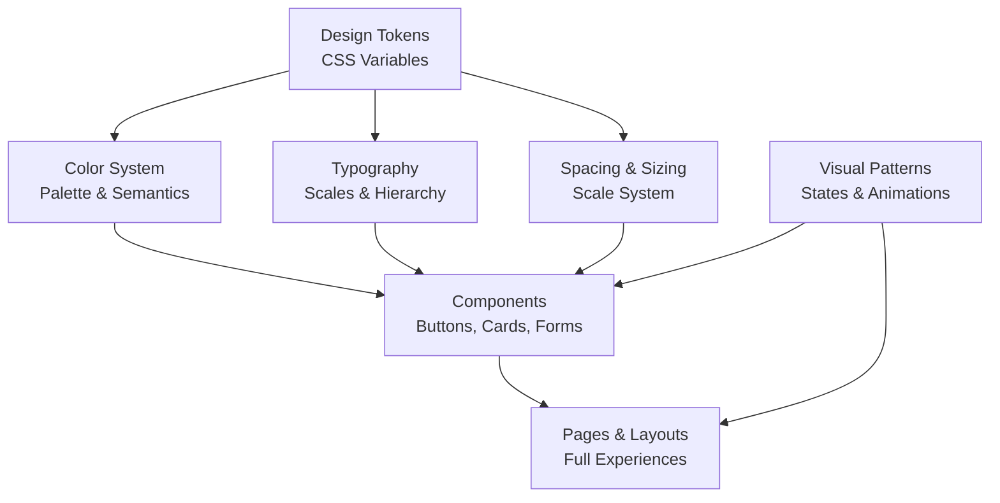

# HauntView UI Design System

## Overview

HauntView is a dark, atmospheric testing platform with a scary Halloween theme. The design system conveys professionalism while maintaining a creepy, Gothic aesthetic. Deep purples, blacks, and dark oranges with subtle supernatural motifs create a haunted digital space. All colors meet WCAG AA contrast standards.

## Architecture

The design system is built on layered foundations:



**System Layers**:

1. **Foundation**: CSS custom properties (--color-_, --space-_, --font-*)
2. **Palette**: Halloween color semantics with WCAG AA compliance
3. **Typography**: Font scale, weights, and hierarchy rules
4. **Components**: Reusable buttons, cards, forms, tables, etc.
5. **Patterns**: Interaction states, animations, feedback
6. **Pages**: Full layouts using components and patterns

## Color Palette

### Primary Halloween Colors

| Name           | Hex     | Use                        |
| -------------- | ------- | -------------------------- |
| Midnight Black | #0F0F14 | Primary backgrounds        |
| Haunted Purple | #582696 | Primary accent             |
| Dark Purple    | #441C78 | Secondary backgrounds      |
| Phantom Purple | #6C3CAA | Highlights, borders        |
| Crimson Orange | #DC6428 | Accent, secondary elements |
| Dark Orange    | #B43C14 | Hover states               |
| Ghostly White  | #F5F5FA | Primary text               |
| Shadow Gray    | #646478 | Secondary text             |
| Deep Gray      | #373746 | Tertiary backgrounds       |

### Semantic Colors

Success: #16a34a | Warning: #ea580c | Error: #dc2626 | Info: #0284c7 | Disabled: #4b5563

## Typography

### Fonts

- **Sans**: Inter (system stack)
- **Display**: Space Grotesk (Google Fonts)
- **Mono**: JetBrains Mono or Fira Code

### Scale (8px base)

| Role           | Size | Weight | Line Height |
| -------------- | ---- | ------ | ----------- |
| Display Large  | 48px | 700    | 1.1         |
| Display Medium | 36px | 700    | 1.15        |
| Heading 1      | 24px | 700    | 1.25        |
| Heading 2      | 20px | 700    | 1.3         |
| Heading 3      | 16px | 700    | 1.35        |
| Body Large     | 16px | 400    | 1.5         |
| Body Regular   | 14px | 400    | 1.6         |
| Body Small     | 12px | 400    | 1.6         |
| Label          | 14px | 600    | 1.4         |
| Code           | 14px | 400    | 1.5         |

**Rules**: Headings use Space Grotesk with optional italic on key terms. Primary text: #F5F5FA. Secondary: #646478.

## Spacing & Sizing

All spacing: 8px base unit (4px, 8px, 12px, 16px, 20px, 24px, 32px, 40px, 48px)
Border radius: 4px → 6px → 8px → 12px → 16px+

Shadows:

```
--shadow-sm: 0 2px 4px rgba(88, 38, 150, 0.1)
--shadow-md: 0 4px 12px rgba(88, 38, 150, 0.15)
--shadow-lg: 0 8px 24px rgba(88, 38, 150, 0.2)
--shadow-xl: 0 12px 32px rgba(88, 38, 150, 0.25)
--glow-sm: 0 0 8px rgba(220, 100, 40, 0.4)
--glow-md: 0 0 16px rgba(88, 38, 150, 0.4)
```

## Components and Interfaces

### Component Structure

All components follow a consistent pattern:

- **Visual Layer**: Colors, spacing, typography
- **Interaction Layer**: Hover, active, focus, disabled states
- **Feedback Layer**: Loading, error, success states
- **Accessibility Layer**: Focus indicators, ARIA labels, semantic HTML

### Buttons

**Primary**: background #582696, color #F5F5FA, border 1px solid #6C3CAA, padding 12px 24px, border-radius 8px, box-shadow 0 4px 12px rgba(88, 38, 150, 0.25)

- Hover: bg #6C3CAA, shadow 0 6px 20px, translateY(-2px)
- Active: bg #441C78, shadow 0 2px 8px
- Focus: outline 2px solid #DC6428
- Disabled: bg #4b5563, cursor not-allowed

**Secondary**: Crimson Orange variant (#DC6428, #B43C14)

**Ghost**: transparent bg, #582696 text, #6C3CAA border. Hover: bg rgba(88, 38, 150, 0.1), border #DC6428

**Sizes**: Small (8px 16px), Regular (12px 24px), Large (16px 32px)

### Cards

```
background: #373746
border: 1px solid rgba(108, 60, 170, 0.3)
border-radius: 12px
padding: 24px
box-shadow: 0 8px 24px rgba(0, 0, 0, 0.4)
transition: all 200ms ease

Hover: border-color rgba(220, 100, 40, 0.5), shadow 0 12px 32px rgba(88, 38, 150, 0.2)
```

### Form Inputs

```
background: rgba(55, 55, 70, 0.5)
border: 1px solid #6C3CAA
color: #F5F5FA
padding: 12px 16px
border-radius: 8px

Focus: border-color #DC6428, box-shadow 0 0 0 3px rgba(220, 100, 40, 0.1)
```

### Tables

Header: background rgba(88, 38, 150, 0.15), border-bottom 2px solid #6C3CAA
Row: border-bottom 1px solid rgba(108, 60, 170, 0.2), hover background rgba(88, 38, 150, 0.08)
Text: primary #F5F5FA, secondary #646478

### Modals

```
background: #0F0F14
border: 1px solid #6C3CAA
border-radius: 12px
max-width: 600px
box-shadow: 0 20px 60px rgba(0, 0, 0, 0.6)

Overlay: background rgba(0, 0, 0, 0.7), backdrop-filter blur(4px)
```

### Navigation

Header: height 64px, background rgba(15, 15, 20, 0.95), border-bottom 1px solid rgba(108, 60, 170, 0.3), backdrop-filter blur(10px)

Nav Item:

- Default: color #646478
- Hover: color #DC6428, background rgba(220, 100, 40, 0.1)
- Active: color #582696, background rgba(88, 38, 150, 0.2), border-bottom 2px solid #DC6428

### Progress

Bar: background rgba(108, 60, 170, 0.2), border-radius 8px, height 8px
Fill: background linear-gradient(90deg, #582696 0%, #DC6428 100%), box-shadow 0 0 8px rgba(88, 38, 150, 0.5)

Skeleton: background linear-gradient shimmer animation at 1.5s

### Alerts

| Type    | Background             | Border  | Text    |
| ------- | ---------------------- | ------- | ------- |
| Success | rgba(22, 163, 74, 0.1) | #16a34a | #86efac |
| Warning | rgba(234, 88, 12, 0.1) | #ea580c | #fed7aa |
| Error   | rgba(220, 38, 38, 0.1) | #dc2626 | #fca5a5 |
| Info    | rgba(2, 132, 199, 0.1) | #0284c7 | #7dd3fc |

Structure: 4px left border, 16px padding, flex with icon (20px), border-radius 8px

### Badges

```
display: inline-flex
align-items: center
gap: 6px
padding: 4px 12px
border-radius: 12px
font-size: 12px
font-weight: 600
```

Variants: Primary (purple), Success (green), Warning (orange), Error (red), Outline

## Interactions

Transitions: --transition-fast: 150ms | --transition-base: 200ms | --transition-slow: 300ms

**Animations**:

- Fade In: opacity 0 → 1
- Slide Up: translateY(8px) opacity 0 → opacity 1
- Pulse: box-shadow cycles 8px → 16px glow
- Spin: 360deg rotation at 2s

**States**:

- Hover: brighten color, translateY(-2px), increase shadow, 200ms
- Active: darken color, translateY(0), reduce shadow
- Focus: 2px solid #DC6428 outline, 2px offset (keyboard)
- Disabled: desaturate #4b5563, opacity 0.6, cursor not-allowed

**Loading**: Circular spinner 2s rotation or skeleton placeholders

**Empty**: text-align center, padding 64px 24px, icon 64px opacity 0.5, title #F5F5FA

## Halloween Theme

**Atmospheric**: Deep desaturated backgrounds (#0F0F14, #373746), purple glow on interactive elements, orange on warnings

**Typography**: Space Grotesk headings with optional italic for ethereal effect

**Icons**: Heroicons (outline) only—no emojis

- Alert: exclamation-circle
- Success: check-circle
- Settings: cog-6-tooth
- Close: x-mark
- Menu: bars-3
- Home: home
- Back: arrow-left
- Search: magnifying-glass
- Download: arrow-down-tray
- Filter: funnel

**Gradients**:

- Background: linear-gradient(180deg, rgba(68, 28, 120, 0.2) 0%, rgba(15, 15, 20, 1) 100%)
- Hover: linear-gradient(135deg, rgba(88, 38, 150, 0.1) 0%, rgba(220, 100, 40, 0.05) 100%)

**Motifs** (3-5% opacity, behind content):

- Spider web patterns in corners
- Skull icon in secondary positions
- Ghost outline in empty states
- Creeping vine SVG at page edges
- Never distracting, always professional

## Data Models

### Typography Model

```
FontStyle {
  family: sans-serif | display | monospace
  size: 12px | 14px | 16px | 20px | 24px | 28px | 36px | 48px
  weight: 400 | 500 | 600 | 700
  lineHeight: 1.1 | 1.15 | 1.25 | 1.3 | 1.35 | 1.5 | 1.6
  letterSpacing: -0.02em | 0em | 0.02em | 0.05em
}
```

### Color Model

```
Color {
  name: string // e.g., "Haunted Purple"
  hex: string  // e.g., "#582696"
  rgb: [number, number, number]
  use: string  // e.g., "Primary accent, interactive elements"
  accessibility: {
    wcagAA: boolean  // true for all primary colors
    contrastRatio?: number  // tested combinations
  }
}
```

### Spacing Model

```
Spacing {
  token: --space-N
  value: 4px | 8px | 12px | 16px | 20px | 24px | 32px | 40px | 48px
  use: string  // e.g., "Default padding", "Card content"
}
```

### Shadow Model

```
Shadow {
  type: "shadow" | "glow"
  depth: "sm" | "md" | "lg" | "xl" | "2xl"
  value: string  // e.g., "0 4px 12px rgba(88, 38, 150, 0.25)"
  use: string    // e.g., "Card elevation", "Button focus"
}
```

### Component State Model

```
ComponentState {
  name: "default" | "hover" | "active" | "focus" | "disabled"
  properties: {
    background?: string
    border?: string
    color?: string
    shadow?: string
    transform?: string
    duration?: string  // e.g., "200ms ease"
  }
}
```

## Error Handling

### Color-Coded Error States

**Input Error**:

- Border: 2px solid #dc2626
- Background: rgba(220, 38, 38, 0.05)
- Error message: font-size 12px, color #dc2626
- Message position: Below input, margin-top 4px

**Form-Level Error**:

- Alert container: 4px left border #dc2626
- Background: rgba(220, 38, 38, 0.1)
- Text: #fca5a5
- Icon: exclamation-circle (Heroicons)

**Recovery Pattern**:

1. Display clear error message with specific issue
2. Highlight affected field
3. Provide actionable suggestion or link to help
4. Show success confirmation after correction

### Empty State Handling

**When no data exists**:

- Centered icon (64px, opacity 0.5)
- Title in Ghostly White (#F5F5FA)
- Description in Shadow Gray (#646478)
- Optional action button (Primary or Secondary)
- Gentle and encouraging tone

### Loading State Handling

**During async operations**:

- Circular spinner (20px or 24px)
- Rotation animation at 2s
- Optional "Loading..." text
- Skeleton placeholders for cards/tables
- Shimmer animation at 1.5s for skeletons

## Responsive Design

**Breakpoints**:

- Mobile: 375px (4-column grid, 12px gutter)
- Tablet: 768px (8-column grid, 16px gutter)
- Desktop: 1200px (12-column grid, 24px gutter)
- Large: 1440px

**Padding**: 16px (mobile), 24px (tablet), 32px (desktop)

**Typography Scaling**:

|         | Display | H1   | H2   | Body |
| ------- | ------- | ---- | ---- | ---- |
| Mobile  | 28px    | 20px | 16px | 14px |
| Tablet  | 36px    | 24px | 18px | 15px |
| Desktop | 48px    | 28px | 20px | 16px |

**Containers**: Max-width 1200px, centered with auto margins

## Microcopy Guidelines

**Error Messages**: Clear, actionable, specific. Tone: helpful, not alarming
Example: "Test failed: JavaScript is disabled in profile settings. [Learn more]"

**Success Messages**: Confirmatory, brief
Example: "Test suite completed successfully"

**Placeholder Text**: Descriptive hints in Shadow Gray (#646478)
Example: "Enter test URL (e.g., https://example.com)"

**Empty State Messages**: Encouraging and provide next action
Example: "No test results yet. Run your first test to get started."

**Loading Text**: "Loading...", "Running tests...", "Generating report..."

**Form Labels**: Clear, concise, associated with inputs via for attribute

**Buttons**: Action verbs (Run Tests, Download Report, View Details)

## Testing Strategy

**Visual Regression**: Screenshot comparisons for each component in light/dark modes
**Accessibility**: axe/pa11y automated checks, keyboard navigation testing
**Responsive**: Viewport testing at all breakpoints (375px, 768px, 1200px, 1440px)
**Interaction**: Hover, active, focus, and disabled states verified
**Performance**: Animation frame rates 60fps, no jank on interactions
**Color**: Contrast ratio verification tool against WCAG AA standards
**Icon**: All icons render correctly at specified sizes (16px, 20px, 24px, 32px, 48px, 64px)

## Correctness Properties

_A property is a characteristic or behavior that should hold true across all valid executions of a system—essentially, a formal statement about what the system should do. Properties serve as the bridge between human-readable specifications and machine-verifiable correctness guarantees._

### Property 1: Design Tokens Define All Design Values

_For all components in the UI, every color, typography, spacing, shadow, and timing value SHALL be defined via CSS custom properties (--color-_, --font-_, --space-_, --shadow-_, --transition-_) and never hardcoded.*

**Validates: Requirements 1.1, 1.3, 1.4, 1.6**

### Property 2: Color Contrast Meets WCAG AA Standard

_For all text and background color combinations used in the UI, the contrast ratio SHALL be ≥ 4.5:1 as calculated by the WCAG formula._

**Validates: Requirements 2.1, 2.2, 2.3, 2.4, 2.5, 2.6**

### Property 3: Typography Hierarchy Is Consistent

_For all typography levels (Display, Heading, Body, Label), the font family, font size, font weight, and line height SHALL match the specifications in the Typography_System._

**Validates: Requirements 3.1, 3.2, 3.3, 3.4, 3.5, 3.6, 3.7, 3.8**

### Property 4: Spacing and Sizing Follow 8px Base Unit Scale

_For all padding, margin, and sizing values in components, the value SHALL be a multiple of 8px (4px, 8px, 12px, 16px, 20px, 24px, 32px, 40px, 48px) as defined in the Spacing_System tokens._

**Validates: Requirements 4.1, 4.2, 4.3, 4.4, 4.5, 4.6, 4.7**

### Property 5: Button State Transitions Are Consistent

_For all button components, the state transitions (default → hover → active → disabled) SHALL apply consistent transforms, colors, and shadow effects with 200ms transition duration._

**Validates: Requirements 5.1, 5.2, 5.3, 5.4, 5.5, 5.6, 5.7, 5.8, 6.1, 6.2, 6.3, 6.4, 6.5, 6.6**

### Property 6: Form Inputs Display Correct Styling in All States

_For all form input components (text inputs, checkboxes, radios, selects), the styling in default, focus, disabled, and error states SHALL match the specified colors, borders, and shadows._

**Validates: Requirements 8.1, 8.2, 8.3, 8.4, 8.5, 8.6, 8.7, 8.8, 9.1, 9.2, 9.3, 9.4, 9.5, 10.1, 10.2, 10.3, 10.4**

### Property 7: Complex Components Maintain Unified Styling

_For all complex components (cards, tables, modals, navigation), the background colors, borders, shadows, and hover states SHALL follow the design specifications consistently across all uses._

**Validates: Requirements 11.1, 11.2, 11.3, 11.4, 12.1, 12.2, 12.3, 12.4, 12.5, 12.6, 12.7, 13.1, 13.2, 13.3, 13.4, 13.5, 13.6, 13.7, 14.1, 14.2, 14.3, 14.4, 14.5, 14.6**

### Property 8: Feedback Components Use Correct Color Coding

_For all feedback components (alerts, badges), each type (success, warning, error, info) SHALL display with the specified background color, border color, and text color._

**Validates: Requirements 15.1, 15.2, 15.3, 15.4, 15.5, 15.6, 15.7, 15.8, 15.9, 16.1, 16.2, 16.3, 16.4, 16.5, 16.6**

### Property 9: Dark Mode Is Comprehensive

_For all UI surfaces in the application, the background colors SHALL be from the dark palette (#0F0F14, #373746, #0F0F14), text colors SHALL be light (#F5F5FA, #646478, rgba(100, 100, 120, 0.7)), and the color-scheme SHALL be set to "dark"._

**Validates: Requirements 17.1, 17.2, 17.3, 17.4, 17.5, 19.1, 19.2, 19.3, 19.4, 19.5**

### Property 10: Responsive Design Adapts at All Breakpoints

_For all responsive layouts, at each breakpoint (375px, 768px, 1200px, 1440px), the padding, grid columns, gutter, max-width, and typography sizes SHALL match the specifications._

**Validates: Requirements 20.1, 20.2, 20.3, 20.4, 20.5, 20.6, 20.7, 20.8**

### Property 11: Keyboard Navigation Is Complete

_For all interactive elements in the UI, Tab navigation SHALL move focus in logical order (left-to-right, top-to-bottom), focus indicators SHALL be visible (2px #DC6428 outline), and modals SHALL trap focus._

**Validates: Requirements 21.1, 21.2, 21.3, 21.4, 21.5, 21.6, 21.7**

### Property 12: Screen Reader Support Is Comprehensive

_For all interactive elements and content in the UI, ARIA labels, semantic HTML, and descriptive text SHALL be present such that screen readers can convey intent and navigation._

**Validates: Requirements 22.1, 22.2, 22.3, 22.4, 22.5, 22.6, 22.7, 22.8, 22.9**

### Property 13: Animation Timing and Performance

_For all animations and transitions, the duration SHALL be within the specified range (150-300ms for microinteractions, 2s for spinners), prefers-reduced-motion SHALL be respected, and animations SHALL maintain 60fps._

**Validates: Requirements 23.1, 23.2, 23.3, 23.4, 23.5, 23.6, 23.7, 23.8, 23.9**

### Property 14: Halloween Theme Is Applied Consistently

_For all UI components, purple (#582696) and orange (#DC6428) SHALL be used as accent colors on interactive elements, all icons SHALL be Heroicons (no emoji), and atmospheric motifs SHALL use 3-5% opacity._

**Validates: Requirements 24.1, 24.2, 24.3, 24.4, 24.5, 24.6, 24.7**

### Property 15: Error Messages Are Clear and Actionable

_For all error states in the UI, error messages SHALL describe the specific issue and suggest resolution, affected fields SHALL be visually highlighted, and summary alerts SHALL link to affected fields._

**Validates: Requirements 25.1, 25.2, 25.3, 25.4, 25.5, 25.6, 25.7**
